<!-- Ather Assadullah Peer (@ather-ops) — profile README -->
<!-- Layout inspired by github.com/tysoncung, rebuilt in a monochrome slate
     palette with no emoji. All motion is either the capsule hero (external)
     or self-hosted SVGs in this repo, so nothing 404s. -->

<!-- HERO -->

<!-- TYPING -->

 

<!-- SOCIAL BADGES -->

 

---

<!-- ABOUT ME -->
## About Me

Self-taught AI/ML engineer building **production RAG systems**, **multi-tool agentic assistants**, and **ML algorithms from mathematical first principles** — no shortcuts, no abstractions I haven't understood at the layer beneath.

| | |
|---|---|
| **Role** | ML / AI Engineer |
| **Focus** | RAG Systems · Agentic AI · LLM Applications |
| **Location** | Bangalore, India — open to remote roles worldwide |
| **Education** | CSE in AI/ML at LPU present |
| **Currently shipping** | Xpect AI (RAG over 8,807 Netflix titles) and Amazn AI (multi-tool agentic assistant) |

**Stack**

| Area | Technologies |
|---|---|
| **Languages** | Python (Advanced), C, C++, SQL |
| **Data** | Pandas, NumPy, Matplotlib, Seaborn |
| **ML / AI** | Scikit-learn, Linear & Logistic Regression, KNN, Naive Bayes, SVM, Ridge, Lasso, Decision Trees, Random Forest, Gradient Boosting |
| **RAG & LLMs** | FAISS, SentenceTransformers, Groq (LiteLLM), Gemini API, ChromaDB, Prompt Engineering, Semantic Search |
| **Agentic AI** | smolagents CodeAgent, Multi-tool Orchestration, Tool Calling, ReAct |

**By the numbers**

| | |
|---|---|
| **GitHub** | 917 contributions in the last year across 14 repositories |
| **LeetCode** | 100+ solved — Array 85, Math 30, Hash Table 24, Binary Search 24 |
| **Badges** | 50 Days Badge 2026 · 100 Days Badge 2026 |
| **ML from scratch** | 9 algorithms in NumPy — Ridge matches Scikit-learn exactly |

**Project evolution:** Classical ML → SQL analytics → RAG → multi-tool agents — every stage deployed live.

---

<!-- PORTRAIT + INFO CARD -->
<table>
 <tr>
 <td align="center" valign="top">
 
 </td>
 <td align="center" valign="top">
 
 </td>
 </tr>
</table>

---

<!-- CONTRIBUTION GRAPH -->
## Contribution Graph

 

 

---

<!-- EDUCATION -->
## Education

**CSE in AI/ML at LPU present**

Self-study parallel track on agentic AI, RAG systems, and mathematical ML foundations.

---

<!-- WHAT I BUILD -->
## What I Build

| Area | Details |
|---|---|
| **RAG Systems** | End-to-end pipelines with FAISS, SentenceTransformers, Groq, Gemini, ChromaDB, Prompt Engineering, Semantic Search — sub-second retrieval at scale |
| **Agentic AI** | smolagents CodeAgent, multi-tool orchestration, tool calling, ReAct agents; LangGraph (learning) |
| **ML from Scratch** | Linear/Logistic Regression, KNN, Naive Bayes, SVM, Ridge, Lasso, Decision Tree, Random Forest, Gradient Descent — built in NumPy |
| **Data Analysis** | Pandas, NumPy, Matplotlib, Seaborn — EDA, data cleaning, feature engineering, outlier treatment |
| **SQL & Databases** | Normalized schema design, JOINs, window functions, aggregations, grouping, CSV reporting (SQLite) |
| **Full-Stack Deployment** | FastAPI, Streamlit Cloud, HuggingFace Spaces, Vercel, Google Sheets API, PyMuPDF |

---

<!-- PRODUCTS -->
## My Projects

| | Project | Description |
|:--:|---------|-------------|
| A | [**Xpect AI**](https://x-ai-test.streamlit.app) | Semantic movie search with RAG over **8,807 Netflix titles** — 384-dim `all-MiniLM-L6-v2` embeddings, FAISS exact top-5 retrieval, Groq `openai/gpt-oss-20b`. Zero to deployment in 15 days, 183 commits. **Live** |
| B | [**Amazn AI**](https://amazn-agentic-ai.streamlit.app) | Multi-tool agentic assistant — smolagents `CodeAgent` routes between Product RAG, Support RAG and live order lookup. Two independent FAISS pipelines, 134-page support KB via PyMuPDF, Google Sheets API for orders. **Live** |
| C | [**PulseMesh**](https://pulsh-mesh.streamlit.app) | Async API intelligence engine — concurrent multi-API aggregation with `asyncio` / `aiohttp`, normalized into one Streamlit dashboard. **Live** |
| D | [**Atlas Agent**](https://github.com/ather-ops/atlas-agent) | Autonomous assistant that reasons, plans and selects tools — date/time, system info and live weather today; RAG memory and multi-agent orchestration planned. **In development** |
| E | [**Hospital Management SQL**](https://github.com/ather-ops/Hospital-Management-SQL) | Relational database design (patients, doctors, appointments, treatments, billing) with multi-table analytical SQL and CSV reporting. **Live** |
| F | [**Rain Predictor App**](https://github.com/ather-ops/Rain-Predictor-App) | Rainfall classification web app — feature pipeline, trained classifier with saved scaler and model, Streamlit interface. **Code** |
| G | [**Customer Churn Predictor**](https://github.com/ather-ops/Customer-churn-predictor) | Customer retention classifier so churn action can be targeted at the right accounts. **Code** |
| H | [**ML Algorithms from Scratch**](https://github.com/ather-ops/Supervised-ML-from-scratch) | Nine algorithms in NumPy — Ridge matches Scikit-learn exactly (MSE 0.4598, R² 0.9767); Titanic random forest at **80.9%** test accuracy. **Code** |
| I | [**Cafe Sales Analysis**](https://github.com/ather-ops/Supervised-ML-from-scratch) | Cleaned 10,000 transactions, IQR removal and capping, then EDA: Salad led revenue, weekdays **Rs 64,897** vs weekends 24,346, ~40% had no location. **Code** |

---

<!-- TECH STACK -->
## Tech Stack

### Languages

### Data & Visualization

### ML / AI

### Agentic AI & RAG

### Tools & Deployment

**Languages:** Python (Advanced), C, C++, SQL
**Data Analysis:** Pandas, NumPy, Matplotlib, Seaborn, EDA, data cleaning, feature engineering
**ML / AI:** Scikit-learn, linear and logistic regression, KNN, Naive Bayes, SVM, Ridge and Lasso, decision trees, random forest, gradient descent, gradient boosting; PyTorch (learning)
**RAG & LLMs:** RAG pipelines, FAISS, SentenceTransformers, Groq API (LiteLLM), Gemini API, ChromaDB, Prompt Engineering, Semantic Search
**Agentic AI:** smolagents (CodeAgent), multi-tool orchestration, tool calling, ReAct agents; LangGraph (learning)
**Tools & Cloud:** Streamlit Cloud, HuggingFace Spaces, Vercel, Git/GitHub, Google Sheets API (gspread), PyMuPDF; FastAPI and AWS (learning)

---

<!-- ACHIEVEMENTS -->
## Key Achievements

| | Achievement | Detail |
|:--:|-------------|--------|
| A | **Amazon ML Summer School 2026** | Top **23%** of 1,34,421 applicants nationwide. Cleared CV + SOP screening; invited to the selection test. |
| B | **Since AI Hackathon 2026** | Accepted to a 72-hour in-person AI hackathon in Turku, Finland (6–8 Nov 2026) with 15 company challenges. |
| C | **Tata Group GenAI Job Simulation** | GenAI Powered Data Analytics — EDA and risk profiling, delinquency prediction, business storytelling, AI-driven collections strategy. |
| D | **100+ LeetCode Problems** | Array 85, Math 30, Hash Table 24, Binary Search 24. Earned the **50 Days** and **100 Days Badges 2026**. |
| E | **Two Production AI Apps** | Xpect AI (RAG, zero to deployment in 15 days; 183 commits) and Amazn AI (multi-tool agent) — both live. |
| F | **917 Contributions in a Year** | Across 14 public repositories, maintained alongside the CSE program. |
| G | **Nine ML Algorithms from Scratch** | Ridge matching Scikit-learn exactly (MSE 0.4598, R² 0.9767) and a Titanic random forest at 80.9% test accuracy. |

---

<!-- COURSES -->
## Relevant Courses & Learning

- **Google ML Crash Course** — neural networks, embeddings, LLMs, RAG (ongoing)
- **Hugging Face Agents Course** — smolagents, ReAct (Units 1–2 completed)
- **Learn PyTorch for Deep Learning (Zero to Mastery)** — in progress
- **Advanced Python** — decorators, generators, async, OOP, type hints (in progress)
- **AWS Cloud Fundamentals** — EC2, S3, Lambda (in progress)
- **Next:** Transformers, LLM fine-tuning (LoRA), AWS deployment

---

<!-- WHAT I BRING -->
## What I Bring to a Team

**Production Velocity** — Shipped Xpect AI (RAG) and Amazn AI (multi-tool agent), zero to live
**Mathematical Depth** — Nine ML algorithms implemented in NumPy, validated line-by-line against Scikit-learn
**Agentic AI Focus** — smolagents CodeAgent, multi-tool orchestration, RAG memory in progress
**Remote Discipline** — Daily commits, written-first communication, no-supervision-required execution

---

 

 **peerather07@gmail.com** · Bangalore, India · Open to Remote

