<!-- Ather Assadullah Peer (ather-ops) — profile README template -->
<!-- Layout inspired by github.com/tysoncung, rebuilt in a monochrome slate
     palette with no emoji. The hero and typing line are external services
     (capsule-render / readme-typing-svg); everything else is self-hosted
     SVG so nothing else can 404 or rate-limit. -->

<div align="center">

<!-- HERO -->


<!-- TYPING -->


<br/>

<!-- SOCIAL BADGES -->
<a href="https://linkedin.com/in/ather-assadullah-164492301"></a>
<a href="https://x.com/PeerAther47970"></a>
<a href="https://portfolio-two-pink-24.vercel.app/"></a>
<a href="https://leetcode.com/"></a>
<a href="mailto:peerather07@gmail.com"></a>


</div>

<br/>

---

## About Me

```python
class AtherAssadullahPeer:
    def __init__(self):
        self.role = "ML / AI Engineer"
        self.focus = ["RAG Systems", "Agentic AI", "LLM Applications"]
        self.location = "Bangalore, India"
        self.education = "CSE in AI/ML at LPU present"
        self.shipping = ["Xpect AI - RAG over 8,807 Netflix titles",
                         "Amazn AI - multi-tool agentic assistant"]

    @property
    def stack(self):
        return {
            "languages": ["Python (Advanced)", "C", "C++", "SQL"],
            "data":      ["Pandas", "NumPy", "Matplotlib", "Seaborn"],
            "ml_ai":     ["Scikit-learn", "Linear/Logistic Regression", "KNN",
                          "Naive Bayes", "SVM", "Ridge", "Lasso",
                          "Decision Trees", "Random Forest", "Gradient Boosting"],
            "rag_llm":   ["FAISS", "SentenceTransformers", "Groq (LiteLLM)",
                          "Gemini API", "ChromaDB", "Prompt Engineering",
                          "Semantic Search"],
            "agents":    ["smolagents CodeAgent", "Multi-tool orchestration",
                          "Tool Calling", "ReAct"]
        }

    @property
    def numbers(self):
        return {
            "contributions": "917 in the last year across 14 repositories",
            "leetcode":      "100+ solved - Array 85, Math 30, Hash Table 24, Binary Search 24",
            "badges":        ["50 Days Badge 2026", "100 Days Badge 2026"],
            "ml_from_scratch": "9 algorithms in NumPy - Ridge matches Scikit-learn exactly"
        }
```

## Contribution Graph

<p align="center">
 
</p>

<p align="center">
 
</p>

---

## Education

**CSE in AI/ML at LPU present**

---

## What I Build

| Area | Details |
|---|---|
| **RAG Systems** | FAISS, SentenceTransformers, Groq, Gemini, ChromaDB, Prompt Engineering, Semantic Search |
| **Agentic AI** | smolagents CodeAgent, multi-tool orchestration, tool calling, ReAct agents; LangGraph (learning) |
| **ML from Scratch** | Linear/Logistic Regression, KNN, Naive Bayes, SVM, Ridge, Lasso, Decision Tree, Random Forest, Gradient Descent — built in NumPy |
| **Data Analysis** | Pandas, NumPy, Matplotlib, Seaborn — EDA, data cleaning, feature engineering, outlier treatment |
| **SQL & Databases** | Normalized schema design, JOINs, window functions, aggregations, grouping, CSV reporting (SQLite) |
| **Full-Stack Deployment** | FastAPI, Streamlit Cloud, HuggingFace Spaces, Vercel, Google Sheets API, PyMuPDF |

---

## My Projects

<div align="center">

| | Project | Description |
|:--:|---------|-------------|
| A | [**Xpect AI**](https://x-ai-test.streamlit.app) | Semantic movie search with RAG over **8,807 Netflix titles** — FAISS exact top-5 retrieval, Groq `openai/gpt-oss-20b`. **Live** |
| B | [**Amazn AI**](https://amazn-agentic-ai.streamlit.app) | Multi-tool agentic assistant — smolagents `CodeAgent` routes between Product RAG, Support RAG and live order lookup. **Live** |
| C | [**PulseMesh**](https://pulsh-mesh.streamlit.app) | Async API intelligence engine — concurrent multi-API aggregation. **Live** |
| D | [**Atlas Agent**](https://github.com/ather-ops/atlas-agent) | Autonomous assistant that reasons, plans and selects tools. **In development** |
| E | [**Hospital Management SQL**](https://github.com/ather-ops/Hospital-Management-SQL) | Relational database design with multi-table analytical SQL. **Live** |
| F | [**Rain Predictor App**](https://github.com/ather-ops/Rain-Predictor-App) | Rainfall classification web app. **Code** |
| G | [**Customer Churn Predictor**](https://github.com/ather-ops/Customer-churn-predictor) | Customer retention classifier. **Code** |
| H | [**ML Algorithms from Scratch**](https://github.com/ather-ops/Supervised-ML-from-scratch) | Nine algorithms in NumPy — Ridge matches Scikit-learn exactly; Titanic random forest at **80.9%**. **Code** |
| I | [**Cafe Sales Analysis**](https://github.com/ather-ops/Supervised-ML-from-scratch) | Cleaned 10,000 transactions, IQR treatment, then EDA. **Code** |

</div>

---

## Tech Stack

<div align="center">

### Languages


### Data & Visualization


### ML / AI


### Agentic AI & RAG


### Tools & Deployment


</div>

---

## Key Achievements

<div align="center">

| | Achievement | Detail |
|:--:|-------------|--------|
| A | **Amazon ML Summer School 2026** | Top **23%** of 1,34,421 applicants nationwide. Cleared CV + SOP screening; invited to the selection test. |
| B | **Since AI Hackathon 2026** | Accepted to a 72-hour in-person AI hackathon in Turku, Finland (6–8 Nov 2026). |
| C | **Tata Group GenAI Job Simulation** | GenAI Powered Data Analytics — EDA, risk profiling, delinquency prediction. |
| D | **100+ LeetCode Problems** | Array 85, Math 30, Hash Table 24, Binary Search 24. **50 Days** and **100 Days Badges 2026**. |
| E | **Two Production AI Apps** | Xpect AI and Amazn AI — both live. |
| F | **917 Contributions in a Year** | Across 14 public repositories. |
| G | **Nine ML Algorithms from Scratch** | Ridge matching Scikit-learn exactly; Titanic random forest at 80.9%. |

</div>

---

<br/>

<div align="center">

 **peerather07@gmail.com** · Bangalore, India · Open to Remote

</div>
